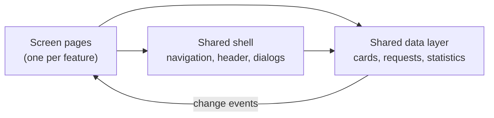
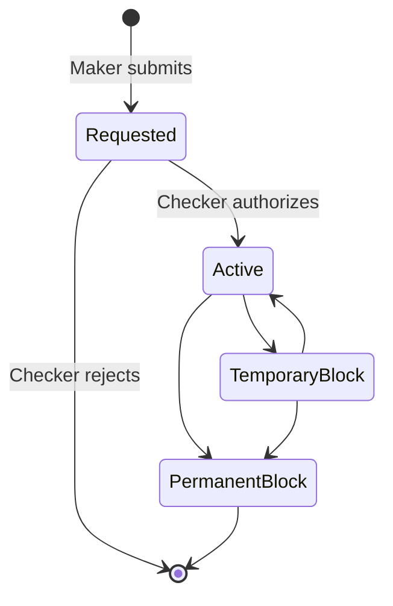

# Corporate Card Management System (CMS)

**A web portal for issuing and controlling corporate payment cards, with maker-checker approval, card status and limit management, and a live portfolio dashboard.**

> **About this repository**
> This project was built in a professional setting and its source code is the property of my employer. This repository is a **portfolio write-up only**: it contains no source code, no client data and no internal system details. Names, figures and workflows are described at a general level.

---

## Overview

Banks issue corporate debit and credit cards to the employees of their business customers. The bank's operations staff need one place to request new cards, approve them under dual control, and then manage each card over its life: blocking it, re-activating it, or changing its spending limit.

I designed and built a **high-fidelity, fully interactive prototype** of this portal so that business stakeholders could walk through every screen and workflow before the production build began. I also produced the **user manual** for the system, generated programmatically so it could be rebuilt whenever the screens changed.

## My Role

- Designed the information architecture, screen layouts and workflows from the business requirements.
- Built all 12 screens as a clickable prototype with realistic interactive behaviour.
- Ran several review rounds with stakeholders and turned their feedback into concrete domain rules.
- Produced a 26-page user manual with field-level documentation and automatically captured screenshots.

## Key Features

**Card management**
- Card request form covering card product, account type, embossed name lines, cardholder identity, initial status and spending limit.
- **Maker-checker approval queue** where a second user authorizes, revises or rejects requests in bulk, with a mandatory rejection reason.
- Searchable card list with masked card numbers, colour-coded status badges and per-card actions.
- Status changes between Active, Temporary Block and Permanent Block, with a reason and a warning before irreversible actions.
- Spending-limit changes by limit type and effective date.
- Read-only card details view with a rendered card visual.

**Portfolio dashboard**
- KPI tiles for total, active, blocked and pending cards.
- A hand-built gauge showing the share of active cards, a status breakdown bar with drill-down into the filtered card list, and a limit summary.

**Administration**
- User creation scoped to a client and company, role management with a permission matrix, self-service password change with a live policy checklist, and administrator password reset with account unlock.

**Platform**
- Shared application shell with a collapsible, permission-style sidebar and live counters.
- Responsive down to phone width, keyboard accessible, and fully offline (no CDN dependencies).

## Tech Stack

| Area | Technology |
|---|---|
| Front end | HTML5, Bootstrap 5, Bootstrap Icons, vanilla JavaScript |
| Visualisation | Hand-built SVG gauge and CSS charts (no chart library) |
| State | In-browser store shared across pages, so full end-to-end flows can be demonstrated without a server |
| Documentation | Node.js document generation, headless browser screenshot capture |
| Production target | ASP.NET Core Razor Pages on .NET 10 |

## Architecture (Prototype)

- **One shared shell** renders navigation, header and common dialogs for every page, mirroring the layout model of the server-rendered production framework so screens can be ported one-to-one.
- **One shared data layer** owns cards and pending requests; any change raises an event so the dashboard, lists and counters stay consistent.
- **A token-based design system** (colour, spacing, radius, elevation, semantic action colours) built on Bootstrap, so the same stylesheet can be reused in production.

## Card Lifecycle

## Engineering Highlights

- **Prototype as a specification.** Building working screens rather than static mock-ups surfaced workflow questions early, such as which actions need dual control and which fields the system should assign automatically.
- **Docs as code.** The user manual is generated by a script, and its screenshots are captured automatically through deep links that open specific screens and dialogs, so documentation never drifts from the UI.
- **Production-minded structure.** No framework and no build step, with a layout and design-token model chosen specifically to port cleanly to ASP.NET Core.

## Skills Demonstrated

`UI/UX design` · `Information architecture` · `Bootstrap 5` · `JavaScript` · `CSS design tokens` · `SVG` · `Accessibility` · `Responsive design` · `Requirements analysis` · `Stakeholder communication` · `Technical writing` · `Documentation automation` · `Banking domain`

---

**Sarim Nadeem** · MSc Computer Science · [LinkedIn](https://www.linkedin.com/in/msarimnadeem) · [GitHub](https://github.com/Sarim375)

*Source code is proprietary and not available. Happy to discuss the design and engineering decisions in an interview.*
